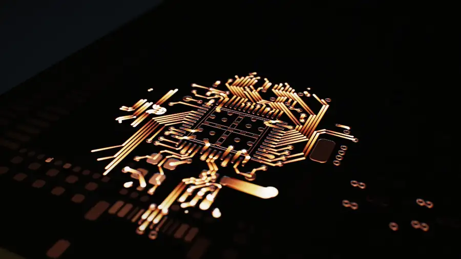
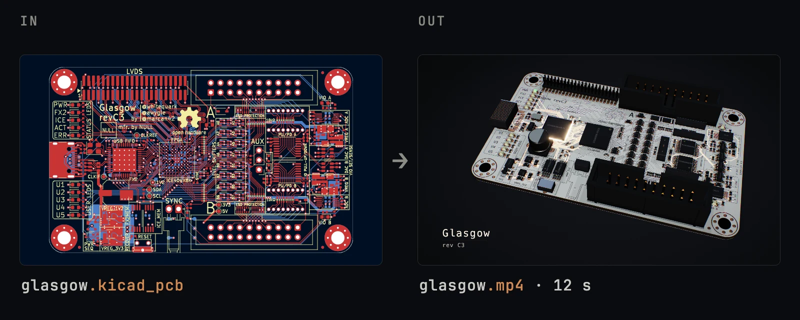
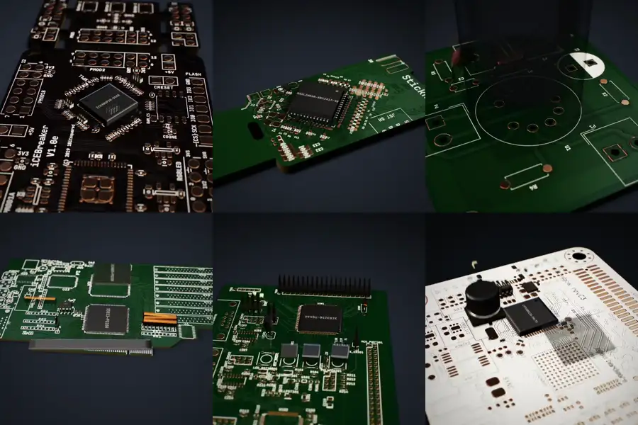
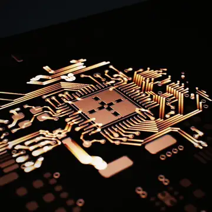
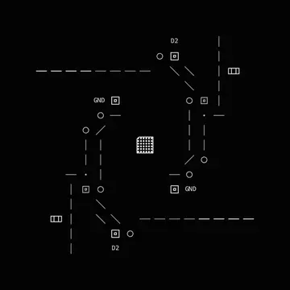
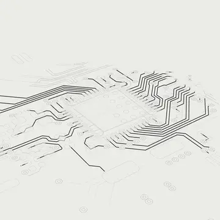

<p align="center">
  <a href="https://silkreel.hridya.tech/studio"></a>
</p>

<h1 align="center">silk reel</h1>

<p align="center">
  <b>Your KiCad board, as a launch film.</b><br />
  Give it a <code>.kicad_pcb</code>. Get a 12-second film of that exact board, built from its real copper, parts and silkscreen, with sound.
</p>

<p align="center">
  <a href="https://silkreel.hridya.tech/studio"><b>Make a film of your board in the browser</b></a>
  &nbsp;·&nbsp;
  <a href="#quick-start">Run it locally</a>
  &nbsp;·&nbsp;
  <a href="https://silkreel.hridya.tech">Website</a>
</p>

<p align="center">
  
  
  
</p>

You finished the board. Now it needs a launch post, and a launch post needs a video. silk reel reads the board file and films it: the copper routes draw out from the main chip, the mask and silkscreen go on, the parts drop onto paste and reflow, and the board powers on. One command, about 30 seconds, no animation skills.

<p align="center">
  
</p>

## Any board

<p align="center">
  
</p>

<p align="center"><sub>iCEBreaker · StickHub · ECC83 preamp<br />KiCad video board · ColdFire dev kit · Glasgow</sub></p>

silk reel picks the part the film is about. It uses each part's own 3D model when KiCad can find it. Every film above came from the board file alone. The only flag was `--aspect 1:1`.

## Three looks

| Trace | Glyph | Plot |
|:---:|:---:|:---:|
|  |  |  |
| The lit board on a studio floor. Scored. | Every part set as type. A seamless loop. | The board drawn in pen on paper. |

Every look renders at 4:5, 1:1, 9:16 or 16:9, so one board gives you the post, the story and the banner.

## Quick start

Install Node.js 22 or later, and put `ffmpeg` and `ffprobe` on your PATH.

```bash
git clone https://github.com/hridaya423/silkreel
cd silkreel
npm ci
npm run reel -- path/to/your-board.kicad_pcb --title "Your Board" --version v1.0
```

The first render downloads a headless Chrome of about 90 MB. Later renders reuse it.

A trace film renders in about 30 seconds on an Apple M4 Pro and is near 8 MB. The CLI also writes `<name>.poster.png`, the last frame, for a cover image. If your machine has no GPU, put `SILK_REEL_GL=swangle` in front of the command.

silk reel reads KiCad 4 and later. It does not read Gerber, Eagle or Altium files.

## Options

| flag | values | default |
|---|---|---|
| `--style` | `trace` · `glyph` · `plot` | `trace` |
| `--aspect` | `4:5` · `1:1` · `9:16` · `16:9` | `4:5` |
| `--format` | `mp4` · `gif` · `webm-alpha` · `prores-alpha` | `mp4` |
| `--hero` | the part the film is about, e.g. `U3` | the IC with the most pads |
| `--mask` | `green` · `black` · `white` · `blue` · `red` · `yellow` · `purple` | the board file's, else `green` |
| `--palette` | `copper` · `mono` · `blueprint` · `phosphor` · `paper` | per style |
| `--title`, `--version` | a title card with the board's name and version | none |
| `--seed` | any number; each one gives a different variation | `42` |
| `--credit` | a small "made with silk reel" line on the last frame | off |

Run `npm run reel -- --help` for every flag. The alpha formats have a transparent background, so you can put the film over your own footage. The same board and flags always render the same film.

### Part models

A trace film shows each part's own 3D model when it finds the STEP file. It reads the model paths in your board the way KiCad does. Add more folders with `--models DIR`. A part without a model keeps an estimated body, and the CLI lists it.

## Share your film

Post the MP4 as it is, or use `<name>.poster.png` as the cover. If you want to credit the tool, add `--credit`. It puts a small "made with silk reel" line on the held last frame of a trace or plot film, and through the whole of a glyph loop. The studio has the same switch under the title card. It is off by default.

## Studio

The [browser studio](https://silkreel.hridya.tech/studio) previews every look for your own board. The tab reads your board file and does not upload it. It records WebM, saves stills, and writes the CLI command for the other formats.

To render every format from a queue, run the full studio on your machine:

```bash
npm run start --workspace=@silk-reel/render-api   # render API on :3102
npm run dev --workspace=@silk-reel/studio         # studio on :3101
```

## How it works

1. [`ingest`](packages/ingest) parses the `.kicad_pcb`: outline, copper on every layer, pads, vias, zones, footprints and silkscreen.
2. [`choreo`](packages/choreo) compiles the board into a timeline. A trace film is four camera shots on a 24-beat grid.
3. [`render`](packages/render) draws each frame. Trace uses WebGL2 with depth of field, HDR bloom and motion blur.
4. [`render-api`](packages/render-api) encodes the frames with Remotion and ffmpeg, and adds the score, mastered to −14 LUFS.

[`cli`](packages/cli), [`studio`](packages/studio), [`site`](packages/site) and [`metrics`](packages/metrics) hold the CLI, the local studio, the website and the video probes.

## Development

```bash
npx tsc --noEmit         # typecheck
npx vitest run           # tests
npx eslint packages      # lint
npm run test:production  # build the studio and smoke-test it
```

Every change to how a film looks goes through a full-video review. [AGENTS.md](AGENTS.md) has the commands and the rubric.

## Credits

- **Sample boards:** [iCEBreaker](https://github.com/icebreaker-fpga/icebreaker) © 2019 1BitSquared, CC BY-SA 4.0. [Glasgow](https://github.com/GlasgowEmbedded/glasgow) rev C3, Glasgow Embedded, 0BSD. StickHub, the ECC83 preamp, the ColdFire dev kit and the video board are KiCad demo projects.
- **Sound:** CC0 recordings from Freesound, listed in [CREDITS.md](packages/render-api/assets/sound/CREDITS.md).
- **STEP reading:** [occt-import-js](https://github.com/kovacsv/occt-import-js) and Open CASCADE Technology, both LGPL 2.1, used unmodified as an npm dependency.
- **Type:** title cards use JetBrains Mono (SIL Open Font License 1.1, [`OFL.txt`](packages/render/src/assets/OFL.txt)), bundled so renders match on every machine.

## License

silk reel is licensed under the [Apache License 2.0](LICENSE). The sample boards, the sound recordings and the fonts keep their own licenses, listed under Credits.
